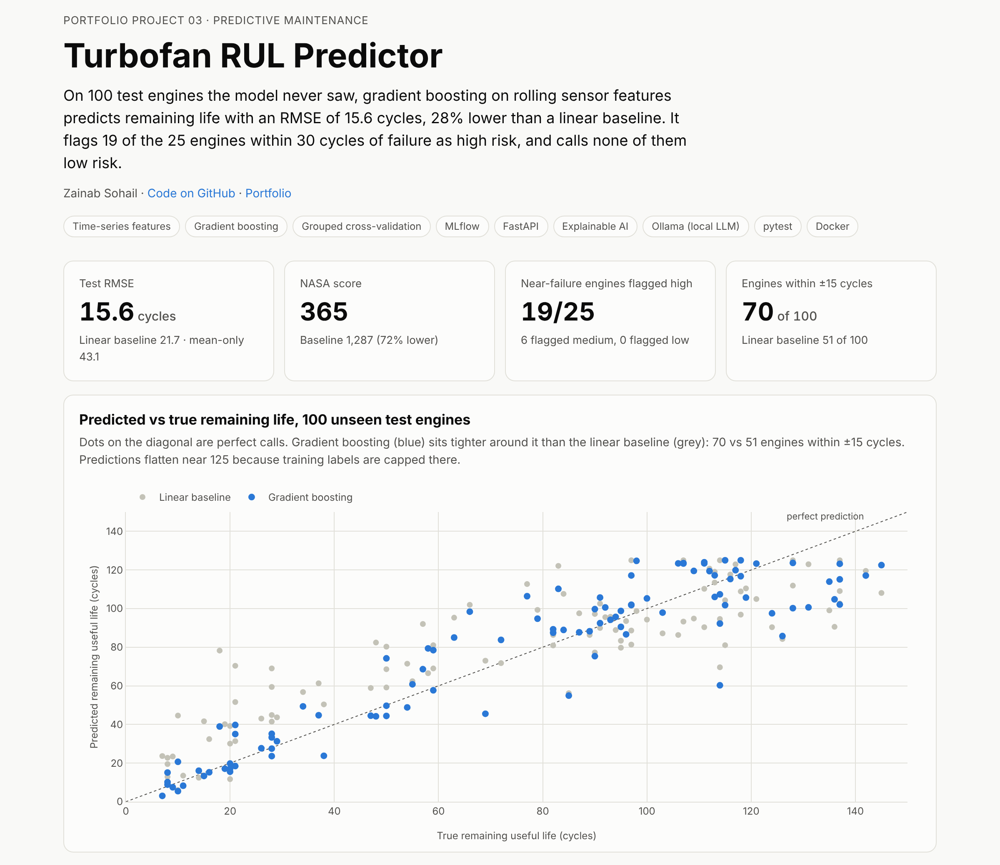
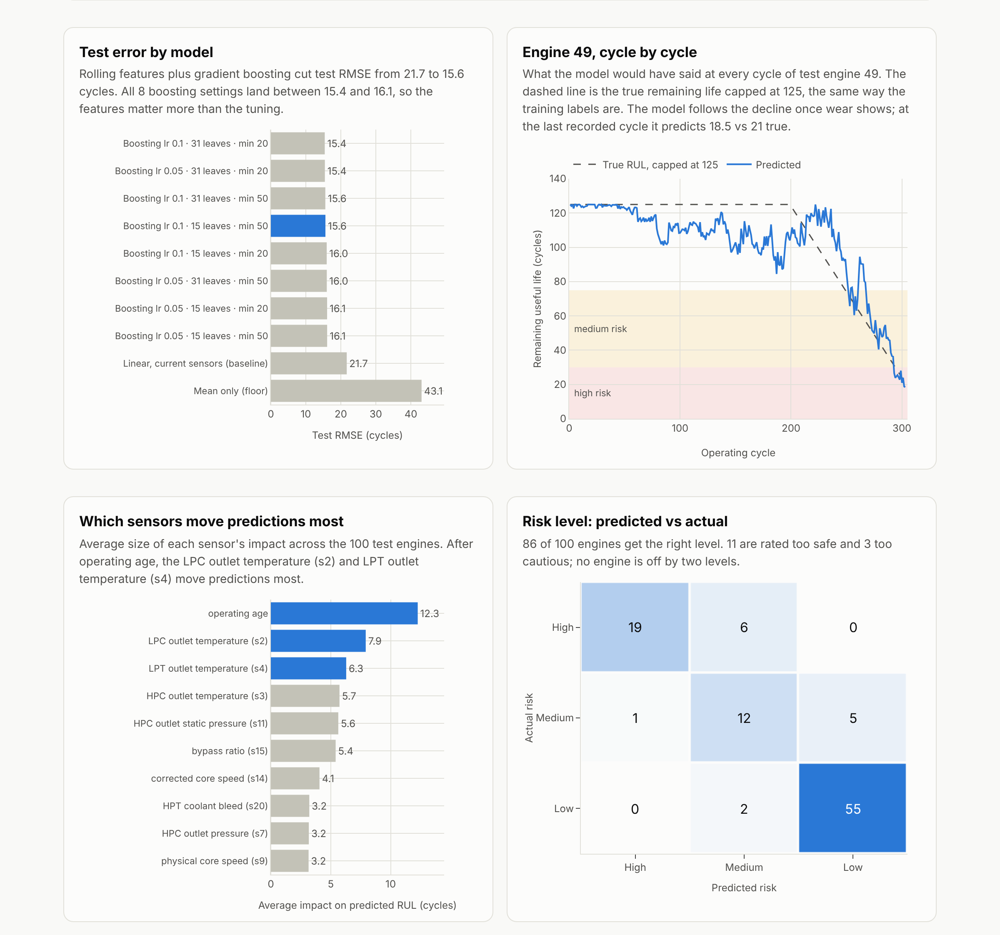
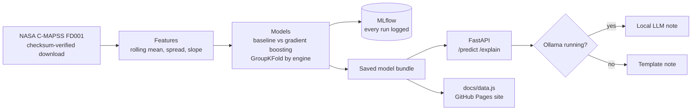

# Turbofan RUL Predictor

**Predicts how many cycles an aircraft engine has left before failure, explains why in plain English, and serves it all through a FastAPI service.**

[**Live demo**](https://xo58gole.github.io/turbofan-rul-predictor/) · [How it's built](#how-its-built) · [Model card](#model-card) · [Run it yourself](#run-it-yourself)


<picture>
  <source media="(prefers-color-scheme: dark)" srcset="docs/img/dashboard-hero-dark.png">
  
</picture>

## The question

Can sensor data tell a maintenance team which engines need attention soon, early enough to plan the work, and can it say *why* in words a manager can act on? This project answers that for NASA's C-MAPSS turbofan engines (subset FD001: 100 engines run to failure for training, 100 cut off early for testing).

## What it does

| Finding | Number |
|---|---|
| Test RMSE, gradient boosting on rolling sensor features | **15.60 cycles** (linear baseline 21.69, mean-only 43.07) |
| Improvement over the linear baseline | **28% lower RMSE**, **72% lower NASA score** (365 vs 1,287) |
| Engines truly within 30 cycles of failure that were flagged high risk | **19 of 25** (6 flagged medium, 0 flagged low) |
| Test engines predicted within ±15 cycles | **70 of 100** (linear baseline: 51 of 100) |
| Engines given the right risk level (high / medium / low) | **86 of 100**; none off by two levels |
| Spread across 8 gradient boosting settings | test RMSE **15.41 to 16.09 cycles**, so the features did most of the work, not the tuning |

**Business takeaway:** no engine that was close to failure got a "low risk" label. A maintenance planner could use the high-risk list to book inspections, and the explanation tells them which part of the engine (compressor temperatures, turbine temperature) is driving each call.



### Explain this prediction

`POST /explain` returns the prediction, each sensor's impact in cycles and a short note. For test engine 31 (true remaining life: 8 cycles):

```text
Engine FD001-test-31: about 15 cycles of useful life left (high risk). Main drivers compared with
a healthy engine: HPC outlet temperature (-21 cycles), LPC outlet temperature (-20 cycles), LPT
outlet temperature (-19 cycles). Recommended action: Schedule an inspection within about 8 cycles
and line up parts for a possible engine removal.
```

That one is the template fallback. With [Ollama](https://ollama.com) running, `llama3.2:3b` writes the note from the same facts instead. The prompt passes only the computed numbers and tells the model not to add any of its own.

## How it's built



| Layer | What happens | Where |
|---|---|---|
| Data | Downloads the 3 FD001 files, checks SHA-256, labels RUL (capped at 125 cycles) | [`scripts/download_data.py`](scripts/download_data.py), [`data.py`](src/turbofan_rul/data.py) |
| Features | Drops 7 flat sensors. For the other 14: current value, 10- and 30-cycle means, 10-cycle spread and slope. 71 features, all looking backwards only | [`features.py`](src/turbofan_rul/features.py) |
| Training | Mean-only floor, linear baseline and 8 gradient boosting settings, 5-fold CV grouped by engine, winner picked on CV RMSE | [`train.py`](src/turbofan_rul/train.py) |
| Tracking | Parameters, CV and test metrics, model and predictions logged to MLflow (SQLite store) | [`train.py`](src/turbofan_rul/train.py) |
| Model bundle | One class holds the estimator, feature logic and explanation code, so the API can't drift from training | [`model.py`](src/turbofan_rul/model.py) |
| Explanation | Per-sensor what-if impacts, turned into a note by Ollama or a template | [`model.py`](src/turbofan_rul/model.py), [`explain.py`](src/turbofan_rul/explain.py) |
| API | `/predict`, `/explain`, `/model/info`, `/sample/{id}`, `/health`, with input validation | [`api.py`](src/turbofan_rul/api.py) |
| Site | `data.js` generated from the saved results, so no number on the page is hand-typed | [`build_site_data.py`](scripts/build_site_data.py), [`docs/`](docs/) |

### Model card

| | |
|---|---|
| Task | Regression: remaining useful life (cycles) at an engine's latest cycle |
| Model | `HistGradientBoostingRegressor`: learning rate 0.1, 15 leaves, min 50 samples per leaf, 300 iterations, L2 1.0 |
| Training data | FD001 train: 100 engines, 20,631 cycles. Labels capped at 125 cycles |
| Validation | 5-fold `GroupKFold` by engine (CV RMSE 14.51 cycles) |
| Test | NASA's official FD001 test set: 100 engines, 13,096 cycles, scored at each engine's last cycle |
| Test metrics | RMSE 15.60 cycles, NASA score 365 |
| Output | Predicted RUL (0 to 125), risk level: high ≤ 30, medium ≤ 75, low above |
| Limits | One operating condition and one fault mode (FD001). Can't predict above 125 cycles by design. Simulated data, not real engines |

### Evaluation

- **Split by engine, never by row.** Rows from one engine are strongly correlated, so a random row split would leak. Cross-validation uses `GroupKFold` on engine ID, and a test checks that no engine lands in both folds.
- **Selection on CV only.** Test scores are logged for every run so the comparison is transparent, but the winner is picked on CV RMSE. On test, three other settings scored slightly better (15.41, 15.44 and 15.57 vs 15.60). I kept the CV choice rather than picking with hindsight.
- **Two metrics.** RMSE treats early and late errors the same. The NASA score penalises late predictions (saying an engine has more life than it does) more heavily, which matches the real cost.
- **About the explanations.** Impacts are a simple what-if: swap one sensor's features for typical healthy-engine values and re-predict. They're easy to explain but don't add up exactly to the prediction. Operating age (cycles run) has the largest average impact (12.3 cycles), followed by LPC outlet temperature (7.9) and LPT outlet temperature (6.3).
- **33 tests** ([`tests/`](tests/)): RUL labels, raw-file parsing, the FD001 file sizes, features that only look backwards and never mix engines, slope correctness, the grouped split, RMSE and NASA score maths, risk thresholds, every API endpoint (valid input, empty input, missing sensors, out-of-order cycles), and the Ollama and template paths of the explanation.

## Run it yourself

**Windows (PowerShell)**. You need Python 3.10 or newer.

```powershell
git clone https://github.com/xo58gole/turbofan-rul-predictor.git
cd turbofan-rul-predictor
powershell -ExecutionPolicy Bypass -File .\run.ps1
```

That one command creates `.venv`, installs packages, downloads the data, trains and compares the models, rebuilds the site data, runs the tests and starts the API. Then open http://127.0.0.1:8000/docs and try `GET /sample/31`, then paste its output into `POST /explain`.

To see the experiments in MLflow (in a second PowerShell window):

```powershell
.\.venv\Scripts\mlflow ui --backend-store-uri sqlite:///mlflow.db
# then open http://127.0.0.1:5000
```

To get LLM-written notes, install [Ollama](https://ollama.com/download), then:

```powershell
ollama pull llama3.2:3b
# keep Ollama running, restart the API, and /explain will use it
```

**macOS / Linux**

```bash
git clone https://github.com/xo58gole/turbofan-rul-predictor.git
cd turbofan-rul-predictor
./run.sh
```

**Docker**

```bash
docker build -t turbofan-rul .
docker run -p 8000:8000 -e OLLAMA_URL=http://host.docker.internal:11434 turbofan-rul
```

**Calling the API from code** (this is how the maintenance copilot in project 4 will use it):

```python
import httpx
readings = httpx.get("http://127.0.0.1:8000/sample/31").json()
print(httpx.post("http://127.0.0.1:8000/explain", json=readings).json()["note"])
```

## Repo layout

```text
turbofan-rul-predictor/
├── src/turbofan_rul/
│   ├── config.py          # paths, column names, RUL cap, risk thresholds
│   ├── data.py            # load raw files, build RUL labels
│   ├── features.py        # rolling time-series features
│   ├── model.py           # model bundle: predict, explain, save/load, metrics
│   ├── train.py           # CV, model comparison, MLflow logging
│   ├── explain.py         # Ollama note with template fallback
│   └── api.py             # FastAPI service
├── tests/                 # pytest: data processing + API
├── scripts/
│   ├── download_data.py   # checksum-verified FD001 download
│   ├── build_site_data.py # writes docs/data.js from reports/
│   └── screenshots.py     # renders docs/img/ with Playwright
├── reports/               # metrics.json, test predictions and attributions
├── docs/                  # GitHub Pages site (index.html, data.js, img/)
├── run.ps1 / run.sh       # one-command setup, train, test, serve
├── Dockerfile
└── requirements.txt
```

## What I'd add next

- Extend to FD002 and FD004, which mix six operating conditions and need per-condition normalisation.
- Try a sequence model (1D CNN or LSTM) on the raw windows and compare it against these features on the same grouped split.
- Add drift monitoring: compare incoming sensor distributions with training and flag engines the model hasn't seen anything like.

## Data and licence

Data: A. Saxena and K. Goebel (2008), *Turbofan Engine Degradation Simulation Data Set*, [NASA Prognostics Data Repository](https://www.nasa.gov/intelligent-systems-division/discovery-and-systems-health/pcoe/pcoe-data-set-repository/), NASA Ames Research Center. Public NASA data. The download script pulls a public GitHub copy and verifies each file's checksum.

Code: [MIT](LICENSE).

---

**Zainab Sohail** · MSc Artificial Intelligence, FAU Erlangen-Nürnberg · [Portfolio](https://xo58gole.github.io/)
